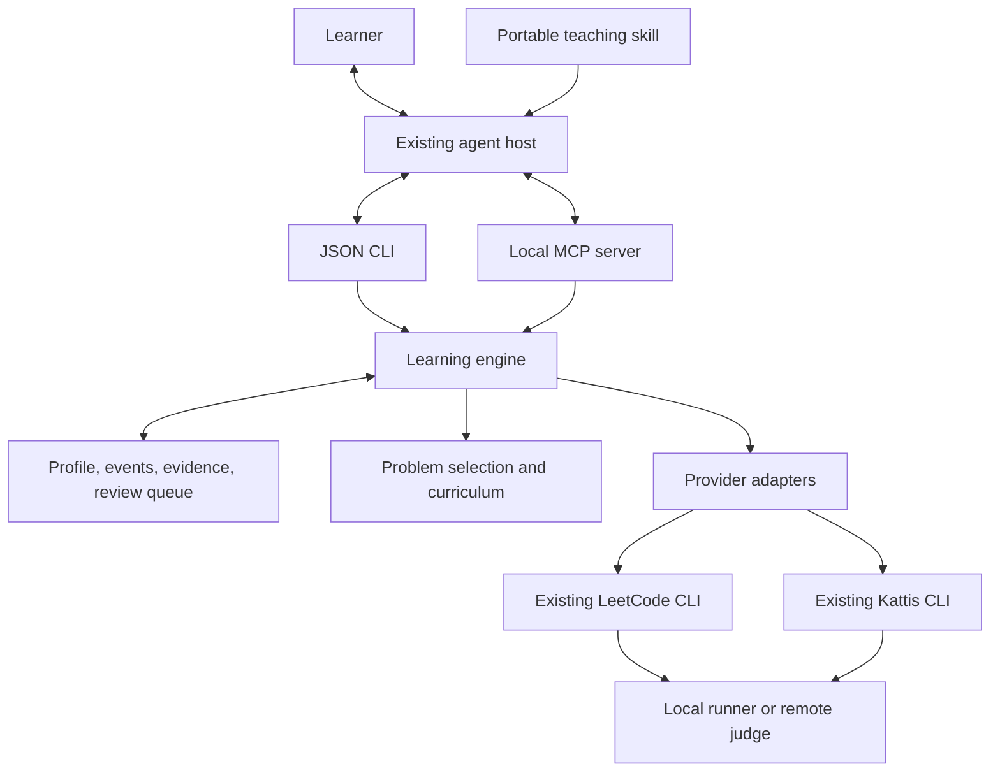

# Agentic algorithm learning: end-to-end plugin plan

Status: implemented on 2026-09-20. Technical acceptance evidence and explicitly
unrun opt-in checks are recorded in [VERIFICATION.md](VERIFICATION.md).

Changed on 2026-10-20: the bundled problem set was removed. Any problem on a
supported judge can be practised and tracked by its `<provider>:<slug>` key;
the concept graph remains. Section 8 and the `problem_search`/`problem_get` rows
in section 11 describe the current behaviour. The concept graph was then
replaced by 18 interview pattern groups (see `curriculum/concepts.json`), and
agents may record free-form `<group>/<pattern>` sub-patterns that planning and
progress roll up under their group; the concept-group table in section 8 is
superseded.

Prepared against this workspace on 2026-09-19. This document defines one complete build and its acceptance contract. The sections describe parts of the finished system, not staged releases.

## 1. Product outcome

Build **Algorithm Learning**, a portable plugin that turns the existing Kattis and LeetCode tools into a persistent algorithm tutor. A learner should be able to say:

> Help me learn algorithms in Odin. I have 30 minutes. Continue from where I stopped, give me useful hints, and make sure I can solve a related problem on my own later.

Any compatible agent should be able to run that session, save evidence, and hand it to another agent without losing the learner's work, hint history, pending judge jobs, or review schedule.

The product's unit of success is a demonstrated skill: recognizing an applicable idea, explaining why it works, implementing it, testing it, and retrieving or transferring it later. Accepted submissions are useful evidence, but do not establish understanding by themselves.

The complete experience includes installation, learner onboarding, diagnosis, a personal study plan, problem selection, guided practice, execution and judging, reflection, assessment, spaced review, progress reporting, and cross-agent continuation. All of these belong to the same delivery.

### Working design decisions

These are proposed product decisions, not additional requirements attributed to the user:

| Decision | Choice and reason |
| --- | --- |
| User experience | Conversation inside the learner's existing agent, backed by a local CLI; no separate dashboard is required. |
| Implementation | Odin for the learning engine and CLI, matching the existing tools. Python remains a development/test dependency where useful. |
| Model ownership | The host agent supplies reasoning and conversation. The plugin does not require another model subscription, vendor SDK, or nested agent loop. |
| Portability | One engine exposed through JSON CLI commands and local MCP, plus portable teaching instructions. Host-specific packaging is a thin adapter. |
| Storage | Private workspace-local files, portable without a hosted database or Git. |
| Default teaching behavior | The learner writes the solution. The agent explains, diagnoses, asks focused questions, and gives progressively stronger help when requested. |
| Practice language | Discover the learner's preference. For this workspace, offer Odin using the existing configuration. |
| Remote execution | Separate language support, local execution, remote example execution, and actual submission. |
| Initial distribution contract | Tested macOS and Linux builds, including source-build instructions. Other operating systems are unsupported until tested; agent portability does not imply universal OS support. |

## 2. Verified starting point and required integration work

The following comes from reading the current sources and documentation, inspecting `.algo`, and running the existing binaries' version/usage paths. This planning task did not rerun algorithm tests, authenticate, or create remote submissions. Earlier verification claims in `PLAN.md` remain historical evidence.

| Area | Observed implementation | Consequence for this build |
| --- | --- | --- |
| LeetCode CLI | `leetcode/` is the implementation; `bin/leetcode` reports `leetcode-odin 0.1.0`. `Makefile` builds, installs, and tests it. | Reuse this client instead of reimplementing website access in the tutor. |
| LeetCode discovery | List/search, filters, show, daily/random, language listing, caching, and account queries are present. Data commands support JSON. | Normalize these results into a provider-independent problem model. |
| LeetCode workspace | `pick` supports fresh destinations and refuses to overwrite them. Odin scaffolds include a runner and editable cases. | Create a separate directory for every attempt and attach stable problem metadata. |
| LeetCode local tests | `test` expects an Odin runner, streams text, and explicitly rejects `--json`. Unchecked expected outputs produce exit code 4. | Add structured local test reporting; do not assume that all CLI commands already return JSON. |
| LeetCode judging | `run`, `submit`, and `check` exist. Job IDs are emitted to stderr before polling; final judge output can be JSON. | Add a durable machine-readable start/check boundary so an agent can resume without parsing human messages. |
| LeetCode languages | Odin is supported for local practice, not for the LeetCode remote judge. Other language starters do not imply local runner support. | Advertise capabilities per provider, problem, language, and operation. Never silently translate a solution for submission. |
| Kattis CLI | `kattis/main.odin` implements list, search, show, get, test, auth, submit, and watch. The binary is `kattis.bin`; `help` prints usage as an unknown command and exits 1. | Add a versioned machine interface and normal help/version behavior before exposing it to agents. |
| Kattis scaffolding | `get` writes into `problems/<id>` and writes `solution.odin` even when the destination already exists. | Add a fresh-destination contract and checked writes. The learning adapter must not call the current `get` against a learner's existing directory. |
| Kattis tests | Compiles and runs Odin sample files with text comparison. No explicit process deadline appears in this execution path. | Add structured outcomes, process deadlines, comparator metadata, and no-tests/unverified distinctions. |
| Kattis submission identity | The problem ID is inferred from the solution's parent folder. Language mappings are static, including an Odin fallback. | Add explicit problem identity and language validation. Attempt directories must not accidentally become problem IDs. Static mappings are not proof of current judge support. |
| Kattis network behavior | HTML parsing and website endpoints are used; submission and polling are coupled. | Add fixtures, bounded network operations, separate submit/check results, and conservative handling of unknown responses. |
| Existing learning data | `.algo/config.json` has format version 1, Odin settings, review intervals `[3, 7, 21, 60]`, a default interval of 1 day, and heavy hint level 3. `.algo/events.jsonl` contains a minimal legacy attempt event. | Import preferences and preserve the original files. An event containing only an ID and timestamp cannot establish a problem identity or mastery. |
| Existing tests | LeetCode unit tests, mock integration tests, and optional live smoke tests exist. `make test` currently targets LeetCode. | Extend verification explicitly for Kattis and learning; a passing current `make test` does not cover the proposed plugin. |

Local sources: [README.md](README.md), [PLAN.md](PLAN.md), [Makefile](Makefile), [LeetCode command parsing](leetcode/cli.odin), [LeetCode local runner](leetcode/workspace.odin), [LeetCode judging](leetcode/judge.odin), and [Kattis implementation](kattis/main.odin).

## 3. Meaning of “any agent”

Support capabilities rather than hard-coding a model vendor. The same learning state and operations must work through these interfaces:

| Host capability | Integration | Experience |
| --- | --- | --- |
| Reads instructions and runs local commands | Load the teaching skill and invoke the JSON CLI. | Complete workflow, including local execution and persistence. |
| Supports local MCP tools | Launch the MCP server and load teaching instructions. | The same workflow through typed tool calls. |
| Supports a native plugin/package format | Install a wrapper containing the skill, server configuration, and launcher. | Easier discovery and installation, with the same core behavior. |
| Only exchanges text | Learner runs commands and shares a generated handoff packet/results. | Assisted manual workflow; the agent must not claim it has executed tools or persisted changes. |
| Runs on another machine | Move or explicitly sync the workspace, then configure that machine's tool paths. | Resume from the same records. Copying a chat transcript alone is insufficient. |

“Any agent” does not mean every host can load the same plugin manifest, access a local filesystem, enforce permissions, or launch stdio servers. Unsupported host capabilities must be disclosed by setup rather than simulated.

Package the teaching instructions using the Agent Skills directory convention: `SKILL.md` with required name/description metadata and focused reference files. Keep the entry point short and load detailed rules as needed. This provides a portable instruction format; discovery and installation still depend on the host. [Agent Skills specification](https://agentskills.io/specification)

Expose local tools over MCP stdio, using newline-delimited JSON-RPC on stdout and diagnostics on stderr. Do not require remote hosting, OAuth for the learning engine, MCP sampling, or proprietary UI extensions. [MCP transport specification](https://modelcontextprotocol.io/specification/2025-11-25/basic/transports)

For Codex, provide a native wrapper using `.codex-plugin/plugin.json`, the shared skills, and an actual `.mcp.json` companion. Also document direct MCP registration. Official Codex documentation describes local stdio server configuration and plugin-provided MCP servers. [Codex MCP documentation](https://developers.openai.com/codex/mcp)

For other agents, generate a setup guide from discovered capabilities. Do not publish invented configuration keys or claim compatibility based only on a product name. Validate at least one non-Codex host and a generic shell client in the release checks.

## 4. Architecture and ownership



The host agent teaches and interprets. The deterministic engine validates operations, records provenance, enforces data invariants, computes schedules, and provides the next useful action. Provider clients own website-specific authentication, fetching, and judging.

| Component | Responsibility | Must not own |
| --- | --- | --- |
| Teaching skill | Session protocol, questioning, hints, feedback, explanation style, and disclosure rules. | Credential access or invented test/verdict evidence. |
| Learning engine | State transitions, attempt identities, event persistence, evidence validation, scheduling, and capability checks. | Free-form model inference presented as a verified fact. |
| Curriculum/catalogue | Concepts, prerequisites, learning objectives, curated problem mappings, and rubrics. | Unreviewed generated tags treated as certain labels. |
| Provider adapters | Normalize provider requests, metadata, capabilities, jobs, and verdicts. | Pedagogical scoring or a duplicated authentication implementation. |
| Execution layer | Run exact source snapshots with limits; return captured results and artifact hashes. | Editing the learner's algorithm to make a test pass. |
| Host wrappers | Installation, command discovery, instruction loading, and host permission integration. | Separate schedules or private progress hidden in host memory. |

A single conversational agent can act as tutor, reviewer, and assessor. These are responsibilities, not a requirement to run multiple agents. The engine remains usable without delegation.

## 5. Finished installation and onboarding experience

All `algolearn` commands in this document are proposed commands to implement. They do not exist in the current workspace.

The distribution contains `algolearn`, compatible provider binaries or a resolver for already-installed versions, shared skills, reference material, schemas, a starter curriculum, and verified host setup instructions. Pin and report the versions of all three binaries; do not assume an arbitrary executable on `PATH` implements the required contract.

Example terminal entry points:

```sh
algolearn doctor --workspace /path/to/practice --json
algolearn init --workspace /path/to/practice
algolearn resume --workspace /path/to/practice --json
algolearn serve --workspace /path/to/practice
```

`doctor` reports the engine/schema versions, provider executables and compatibility, compiler availability, workspace access, available language runners, offline catalogue availability, and host integration readiness. Account verification is an explicit option; ordinary diagnosis must not launch login or send code remotely.

`init` creates private learning storage without modifying existing solutions. It detects legacy `.algo` data and produces a migration preview. It asks a compact onboarding question covering the learner's goal, preferred language, experience, explanation language, and usual time budget. Previously stored preferences are shown for correction instead of being asked again.

The profile should support goals such as foundations, interviews, contests, and a selected topic. Store goal and time budget separately from skill assessment. A user saying “intermediate” is a starting preference, not evidence that every prerequisite is mastered.

Offer a short diagnostic unless the learner wants to start a chosen problem immediately:

1. Ask them to explain a small example and the relevant constraints.
2. Ask for a direct approach and its cost.
3. Use one short implementation or tracing exercise appropriate to their experience.
4. Record which concepts were observed and which remain unknown.
5. Suggest the next session with a reason; allow the learner to override it.

The diagnostic is interruptible. Do not make users complete a long questionnaire before they can practice. Account login is only needed when they choose a capability requiring it, and credentials stay in the provider's existing login flow.

## 6. Learner-facing commands and complete session workflow

Natural language is the primary interface. Suggested shortcuts are aliases for the same workflow, not a requirement for host compatibility.

| Learner intent | Agent behavior | Persisted result |
| --- | --- | --- |
| “Teach me algorithms” | Load profile, offer diagnosis or a starting exercise, explain the study plan. | Profile, diagnostic evidence, selected learning objective. |
| “Continue” | Load the latest checkpoint, inspect changed source, reconcile pending jobs, and state the next action. | A resumed session linked to the same attempt. |
| “I have 20 minutes” | Select a bounded exercise or review and allow a checkpoint at the time limit. | Session budget and selected task. |
| “Practice binary search” | Check relevant prerequisites and choose a suitable problem with tags hidden during independent recognition. | Selection reason and target concept IDs. |
| “Help me understand this problem” | Clarify examples and constraints without supplying the algorithm unless requested. | Relevant understanding evidence and assistance record. |
| “Give me a hint” | Supply one appropriate hint, record its actual disclosure level, and wait for the learner to act. | Hint content reference, level, and time. |
| “Check my code” | Read the exact file, distinguish algorithm mistakes from language mistakes, and suggest a focused check. | Review evidence tied to a source hash. |
| “Run my tests” | Execute through the matching runner and report verified results and unchecked cases separately. | Run artifact and comparator provenance. |
| “Submit this” | Resolve the exact problem, language, and source snapshot; use the user's authorization and track the resulting job. | Submission intent, source hash, job ID, and verdict. |
| “Show me the full solution” | Honor the request, explain it, record solution exposure, and schedule a later fresh attempt. | Assisted study evidence; no independent-solve credit. |
| “What should I review?” | Show due tasks, prerequisite gaps, and a reason for each recommendation. | Queue unchanged until the learner starts/completes a review. |
| “How am I doing?” | Separate accepted, assisted, independent, retained, and unverified work. | A report derived from evidence, not a new assessment. |

### Session protocol

1. **Restore context.** Load profile, goal, current plan, active attempt, assistance already received, open misconceptions, due reviews, and pending jobs. Do not infer these solely from the conversation.
2. **Choose one objective.** State the concept and expected learning outcome, for example “justify the loop boundary and test the smallest valid input.” In an independent assessment, avoid naming the hidden solution pattern.
3. **Select or accept a problem.** Explain suitability without revealing its solution. Respect the learner's explicit selection even when it differs from the recommendation; record the override without penalizing it.
4. **Prepare a fresh attempt.** Fetch/cache the statement, create the appropriate scaffold, preserve earlier attempts, and record provider identity and language support.
5. **Establish understanding.** Ask the learner to restate inputs, outputs, constraints, and one example. Correct a misunderstanding before escalating algorithmic help.
6. **Develop a plan.** Invite a direct approach, a complexity estimate, and a correctness argument suitable to the learner's level. Accept concise answers; do not demand a formal proof for every exercise.
7. **Let the learner implement.** The agent may clarify syntax or explain diagnostics. Record meaningful assistance and any agent-authored solution changes.
8. **Test deliberately.** Ask for edge cases and predicted outputs, execute samples and validated extra cases, then discuss one concrete failure at a time.
9. **Use the judge when appropriate.** A remote example run and a full submission are distinct actions. Preserve the exact tested/submitted artifact and pending job state.
10. **Reflect and assess.** Ask why the solution works, what its cost is, and how a changed constraint affects the approach. Identify demonstrated concepts and remaining uncertainty.
11. **Schedule retrieval or transfer.** Pick a future recall task and, when appropriate, a different problem requiring the same idea. Do not immediately replay the same memorized solution as independent mastery.
12. **Close or checkpoint.** Save a short learner-facing summary, evidence-backed progress, review date, source location, and next action. A stopped session is a resumable attempt, not a failed learner.

These are interaction steps, not gates that force the learner to answer every question. The agent can move directly to a requested action and record skipped evidence as unknown.

### Session lifecycle

Keep session status separate from the current teaching activity. Status is `active`, `paused`, or `closed`; activity is `understanding`, `planning`, `implementing`, `testing`, `reflecting`, or `reviewing`. A learner can move between activities without falsely completing skipped evidence.

| Event | Transition and invariant |
| --- | --- |
| Start | Create an active session with its objective and optional review-item ID. |
| Checkpoint | Save the current activity and next action; optionally pause. No mastery or review completion is implied. |
| Resume | Reopen a paused session, inspect source changes, and retain its attempt and assistance history. |
| Close | Record `completed`, `stopped`, or `abandoned` as the closure reason and apply eligible assessment/review updates once. |
| Late judge observation | Attach the result to the original job/attempt, including after closure; do not invent the learner's missing explanation. |
| Return to closed work | Create a linked new session; create a fresh attempt for an independent retry. |

Repeated closure cannot advance a review twice, even with a different request ID. To correct a closure or assessment, append an explicit correction and recompute the affected projection. A review session identifies the exact queue item it is evaluating; ordinary practice does not silently clear unrelated due reviews.

### Modes

| Mode | Behavior | Credit |
| --- | --- | --- |
| Guided learning | Progressive hints, worked micro-examples, discussion, and focused debugging. | Credits demonstrated reasoning with assistance recorded. |
| Independent practice | No unsolicited algorithm hints or solution lookup. Clarify wording and tooling when asked. | Eligible for independent evidence if assistance stays within the defined limit. |
| Assessment | Fresh task, explicit conditions, hidden topic labels and old solutions, feedback after the learner responds. | Records observed performance under those conditions, never claims an agent can police external resources. |
| Review | Recall, trace, proof sketch, fix a misconception, or implement again in a new directory. | Updates the relevant review item, not every topic attached to the problem. |
| Worked example | Explain a requested solution, annotate execution, and ask comprehension questions. | Learning exposure; independent implementation credit requires a later fresh attempt. |

## 7. Teaching, hinting, and feedback contract

The tutor should keep the learner doing the cognitive work. It should ask one useful question at a time, offer a short explanation when a question is not helping, and adapt to the learner's requested pace. It must not turn every response into another question or withhold an explicitly requested explanation.

Use this assistance scale consistently:

| Level | Help disclosed | Example category |
| --- | --- | --- |
| 0 | No problem-solving assistance. | Tool execution, progress display, or neutral encouragement. |
| 1 | Wording clarification, a request to trace a case, or language/tooling help that does not supply the algorithm. | “What happens when the input has one element?” |
| 2 | Direction toward a concept or useful observation. | Pointing out repeated work or suggesting a data structure family. |
| 3 | The central invariant, algorithm structure, detailed pseudocode, or the decisive correction. | Giving the missing recurrence or the required order of operations. |
| 4 | Full solution, editorial walkthrough, or agent-written implementation. | Complete source or a translation of a complete solution. |

Record the content actually delivered. A “syntax hint” that gives the decisive algorithmic fix must receive the higher level. Repeated hints may cumulatively reveal the algorithm; record both maximum level and cumulative disclosure. Preserve the existing heavy-hint threshold of 3 when importing this workspace's preferences.

Before a hint, inspect the learner's last explanation, code, and previous hints. Start with the smallest helpful disclosure that matches the request. If the user asks for stronger help, provide it and update the assistance record. Do not make them repeatedly prove that they deserve help.

Ordinary “help,” “check,” or “hint” requests do not authorize replacing the learner's solution. An explicit request to implement or fix code does; store the diff/source hash and mark the attempt assisted. Harness repairs belong to tooling evidence, except where the repair also gives away the algorithm.

For wrong answers, report the observed counterexample and invite a prediction or trace before proposing a change. Distinguish these causes:

- Misread specification or invalid assumption.
- Incorrect algorithm, invariant, recurrence, or complexity.
- Boundary, indexing, state-update, overflow, or representation error.
- Programming-language/compiler issue.
- Harness, comparator, provider, or environment issue.

A timeout or provider outage is not a learner misconception. A compiler error does not erase a correct complexity explanation. Feedback should name the specific evidence and one next action.

Do not fetch editorials, discussion solutions, or the learner's old accepted source during independent work unless they request that help. If answer-bearing material is accidentally exposed, record the exposure and choose a fresh assessment task. Provider topic tags and generated metadata can also reveal the technique; omit them from the learner-facing assessment view.

The agent's rubric judgment is fallible. Store a short rationale and the learner's relevant observable response, not private model reasoning. The learner can correct a misattributed response or challenge a score; corrections are new events with provenance.

## 8. Curriculum, diagnosis, and problem selection

Represent the curriculum as a versioned prerequisite graph. Nodes are concrete concepts with an observable outcome, a short explanation, common misconceptions, a diagnostic prompt, a rubric, and several exercise mappings.

| Concept group | Representative outcomes | Typical prerequisites |
| --- | --- | --- |
| Foundations | Parse input, trace loops, reason about integer bounds, estimate time/space. | Basic language use. |
| Arrays and strings | Traverse safely, reason about indices, maintain simple state. | Foundations. |
| Maps and sets | Explain lookup use, frequency counts, and duplicate handling. | Arrays and cost models. |
| Sorting and search | Define order assumptions, derive binary-search boundaries and termination. | Arrays, invariants, complexity. |
| Prefix sums, two pointers, windows | Identify reusable aggregates and state when a moving boundary is valid. | Arrays, invariants; sometimes sorting. |
| Stacks, queues, linked structures | Choose operations and reason about state/order. | Basic data structures. |
| Recursion and backtracking | Define state, base case, progress, and undo operations. | Functions and tracing. |
| Trees and graphs | Choose representations, traverse, track visited state, and reason about reachability. | Recursion or queues/stacks. |
| Heaps, greedy methods, disjoint sets | Explain ordering/choice rules and justify when they are valid. | Sorting, invariants, graph basics as appropriate. |
| Dynamic programming | Derive state, transitions, base cases, evaluation order, and space use. | Recursion, dependency reasoning, complexity. |

These groups are a curriculum outline, not rigid levels every learner must follow. Store edges per concept: for example, heap use should not automatically require every graph concept.

Do not bundle a problem set. Any problem on a supported judge can be practised and tracked by its key `<provider>:<slug>`; the provider tools supply its statement, examples, and metadata. Each concept lists the provider topic tags that practise it, so recommendations point at the provider's own catalogue. A problem may cover several concepts, but cannot provide all the evidence for all of them; the agent records which concepts a session actually exercised. Keep platform difficulty in its original scale. A Kattis rating and LeetCode difficulty must not be converted by an invented universal formula.

### Deterministic selection policy

1. Apply hard constraints: selected language/mode, access, offline availability, available time, active contest constraints supplied by the learner, and explicit exclusions.
2. Honor a specific user request; explain missing capabilities if it cannot be executed as requested.
3. Otherwise prefer a due review within the learner's review budget, then a blocking prerequisite, then the current goal's next concept, then a transfer exercise.
4. Within that category, prefer exercises with reliable metadata, suitable effort, and less recent exposure. Avoid serving a worked solution again as a fresh assessment.
5. Use a stable tie-break or stored random seed so recommendations can be explained and reproduced.
6. Return up to three candidates with a concise reason and capability limitations. Let the learner pick or accept the first.

Default to one review and one new/transfer objective per session, reducing this for short sessions. If no suitable cached problem exists offline, offer a cached review or a clearly labeled tutor-created micro-exercise. Do not claim the generated exercise is an official provider problem or has hidden judge coverage.

Adapt from observations: repeated conceptual trouble suggests a smaller prerequisite exercise; repeated independent success suggests less scaffolding or a transfer task. Do not increase difficulty because an agent-assisted submission was accepted.

## 9. Evidence model, assessment, and review scheduling

Keep four separate views:

1. **Execution:** what compiled or ran, under which tests/comparator, from which source.
2. **Judge outcome:** remote example result or full submission verdict for a specific provider job.
3. **Assistance:** hints, solution exposure, edits, and language translation.
4. **Learning:** what the learner demonstrated, how it was assessed, and what remains unknown.

### Assessment rubric

Score each applicable dimension independently: recognition, approach/invariant, correctness explanation, complexity, implementation/testing, and transfer. Use `unknown` when not observed; otherwise 0 = incorrect, 1 = partial, 2 = correct with meaningful prompting, 3 = independently justified. A short trace can establish a narrow concept without establishing the whole algorithm.

Each judgment references evidence IDs, the rubric version, assistance received before the response, and an assessor identity. Confidence is a qualitative evidence label (`insufficient`, `limited`, `supported`), not a fabricated probability. Automated tools verify execution; the agent proposes semantic judgments; deterministic rules decide whether those judgments meet a progress threshold.

An **independent qualifying solve** requires:

- A fresh attempt with no algorithm-bearing solution exposure or agent-authored algorithm changes, and assistance no higher than level 1.
- Score 3 with supporting evidence for the applicable approach, correctness, and complexity dimensions.
- Verified implementation behavior using nontrivial validated cases or the relevant judge, with evidence strength displayed. Sample-only evidence stays explicitly limited.
- Evidence attached to the concept actually demonstrated, rather than copied to every provider tag.

Use concept states `unknown`, `introduced`, `practicing`, `independent`, and `retained`:

- `introduced`: a lesson or worked example was completed.
- `practicing`: the learner demonstrated partial or assisted understanding.
- `independent`: at least one qualifying independent solve for this concept.
- `retained`: at least two distinct qualifying problems, including one transfer exercise, plus a successful delayed retrieval at least three days after the relevant learning exposure.

A retrieval item has explicit criteria: explanation/trace tasks require an independent correct response; an implementation task also requires verified implementation behavior. Partial dimensions remain visible. These thresholds are configurable product heuristics to evaluate with learners, not claims of scientifically guaranteed mastery.

Previously accepted work imported from a provider is `prior_practice` unless assistance and reasoning evidence are available. Do not manufacture historical learning scores from a solved-count endpoint.

### Review queue

Use the existing workspace defaults where present: initial review after 1 day; after an independently successful review, intervals of 3, 7, 21, then 60 days from the actual completion time. Store an interval index per review item; cap repeated successful intervals at 60 days. A qualifying independent first solve starts a new item due in 1 day; its first successful review schedules the 3-day interval.

Assisted study and completed worked examples also create a 1-day retrieval item, with no independent credit. Merge duplicate open items for the same concept and retrieval objective instead of adding one for every conversation turn. Preserve the source evidence and use the earliest applicable due date unless the learner snoozes it.

| Outcome | Queue update | Learning update |
| --- | --- | --- |
| Independent correct recall | Advance one interval; schedule from completion. | Add evidence for the reviewed concept/dimension. |
| Correct after meaningful help | Reset to the initial 1-day interval. | Record assisted success; no independent promotion. |
| Incorrect conceptual recall | Reset to 1 day and attach a targeted remediation task. | Record the lapse and mark current retention as needing review. |
| Tool failure, timeout, or missing expected output | Leave interval progress unchanged; offer a retry. | No negative learning inference. |
| Skipped or interrupted | Keep due status or a learner-chosen snooze. | No failure score. |

Store timestamps in UTC and display/schedule calendar dates using the profile's IANA timezone. Use `Asia/Ho_Chi_Minh` only if selected/imported for this learner; do not hard-code it for all users. Preserve overdue items without multiplying missed daily tasks. Limit a session's review load and allow snoozing without pretending it completed the review.

Retain historical achievements after a lapse while showing current recall uncertainty. A learner returning after months should receive a short recalibration task, not a claim that every old score remains current or that all progress has been lost.

## 10. Durable workspace and data contracts

Keep the existing problem directories and credentials in place. Put the new schema under `.algo/learning/` so existing `.algo/config.json`, `.algo/events.jsonl`, and backups are not overwritten.

```text
practice-workspace/
  problems/                         existing and new provider attempt files
  .algo/
    config.json                     legacy file, preserved
    events.jsonl                    legacy file, preserved
    learning/
      manifest.json                 schema/workspace identity and installed versions
      events.jsonl                  authoritative learning event stream
      state.json                    replaceable projection, with last applied sequence
      sessions/<session-id>/        checkpoints and handoff documents
      attempts/<attempt-id>/        metadata and immutable source/test snapshots
      artifacts/<artifact-id>/      run reports and learner-visible evidence
      jobs/<job-id>.json             recoverable job projection
      imports/                      source hashes, mappings, and unresolved records
      backups/                      migration/recovery backups
```

New attempt code can live at `problems/<provider>/<slug>/<attempt-id>/`. Store its path explicitly; never recover problem identity from the folder name. Existing `problems/tarifa` or `problems/1-two-sum-typescript` can be registered in place without moving them.

| Record | Required fields and invariants |
| --- | --- |
| Profile | Learner ID, goal, language preferences, experience self-report, time budget, timezone, teaching preferences, and authorization policy references. |
| Problem | `problem_key` such as `leetcode:two-sum`, provider-native ID/slug, canonical URL, title, access, input/output model, limits, concept mappings with provenance, fetched timestamp, content hash, and capability snapshot. Tutor-created exercises use `local:<id>`, retain their author/oracle provenance, and have no claimed provider URL or remote judge. |
| Session | Session ID, learner ID, objective, mode, budget, host identifier, current attempt, workflow state, and checkpoint sequence. |
| Attempt | Attempt ID, problem key, language, source path, creation time, previous-attempt link, exposure/assistance summary, and current status. One attempt never changes provider identity. |
| Evidence | Evidence ID/type, subject, producer (`tool`, `learner`, `agent`, `import`), observed time, artifact/source hash, verification scope, and relevant content/reference. |
| Assessment | Concept/dimension, score or unknown, evidence IDs, rubric/policy version, short rationale, assessor, and correction/supersession link. |
| Review item | Review ID, concept/dimension, task type, origin evidence, interval index, due date/timezone, last outcome, and current due/snoozed/completed state. |
| Remote job | Provider, account alias, operation (`example_run` or `submission`), remote ID when known, problem key, source/language hash, local intent ID, state, timestamps, and last observation. |
| Event | Unique event ID, sequence, schema version, workspace ID, timestamp, actor, event type, request ID, relevant entity IDs, and validated payload. |

Example event shape, with illustrative identifiers:

```json
{
  "schema_version": 1,
  "event_id": "ev_000042",
  "sequence": 42,
  "workspace_id": "ws_example",
  "timestamp": "2026-09-19T15:00:00Z",
  "actor": {"kind": "agent", "host": "generic-cli"},
  "type": "hint_delivered",
  "request_id": "req_hint_7",
  "session_id": "session_example",
  "attempt_id": "attempt_example",
  "payload": {
    "level": 2,
    "artifact_id": "artifact_hint_7",
    "concept_ids": ["hash-lookup"],
    "source_hash_at_delivery": "sha256:example"
  }
}
```

Use collision-resistant IDs in implementation, not the short example IDs. Hash source bytes, tests, relevant runner/comparator configuration, and policy versions so later reports can explain what was actually evaluated.

### Persistence rules

- Learning-changing commands append validated events under a workspace lock. Rebuild profile, schedule, and progress projections deterministically from events and pinned policy/catalogue versions.
- A mutating request carries a unique request ID and expected workspace revision. Repeating an identical request returns its existing result; reusing its ID for a different payload fails. A stale revision returns a conflict with the current revision.
- Use short local transactions: never hold the workspace lock while waiting on the learner or a remote judge. Reserve an operation, release the lock, do bounded work, then append its observation.
- Write projections using a temporary file and atomic replacement. If a projection is missing or behind, replay committed events. Do not use a cached progress summary as the source of truth.
- On a truncated final JSONL record, preserve the original and offer verified recovery to the last complete record. Corruption in the middle stops writes and requires repair; do not silently discard history.
- Support schema migrations with dry-run validation, backups, source hashes, and rollback. A migration must never upgrade incomplete legacy evidence into a successful solve.
- Local locks and revision checks support multiple local clients. Simultaneous writers to asynchronously synced copies are unsupported; export/import detects duplicate and conflicting event IDs instead of guessing a merge.

### Legacy `.algo` import

Map track/language and interval preferences after validation. Treat the old `test_command` as inert legacy data: do not execute an imported shell template automatically. Register an explicit supported runner instead.

Import an event such as `{"id":"001","event":"attempt"}` as an unresolved historical record. Do not assume `001` means LeetCode Two Sum. Permit the learner to map it to a problem later; keep the original bytes, source hash, and mapping event. Reimporting the same source is idempotent. Existing `.bak` files are preserved and are not automatically concatenated, since they may duplicate events.

## 11. Core API, CLI, and MCP contract

Define the operation registry once, then generate CLI dispatch documentation and MCP tool schemas from it. Both frontends call the same handlers and return the same domain results.

Every operation accepts a workspace context bound by the launcher. Mutations also require `request_id` and `expected_revision`; creation into an empty workspace uses revision 0. Paths are workspace-relative unless explicitly configured by the learner. Reject unexpected fields and invalid enums rather than quietly ignoring them.

The generic CLI form is:

```sh
algolearn call session_resume --workspace /path/to/practice --input request.json --json
```

Read JSON from a file or stdin so text, paths, and learner responses do not require shell interpolation. Convenience commands such as `init`, `doctor`, and `resume` wrap the registry; they do not implement different behavior.

| Operation / MCP tool | Specific input | Result and effect |
| --- | --- | --- |
| `workspace_init` | Profile answers and import selection. | Initialize storage, record profile/migration events, return capabilities. |
| `doctor` | Optional provider/account checks. | Readiness, incompatibilities, and actionable remedies; no implicit login. |
| `profile_update` | Validated preference changes. | Versioned profile/policy change; reports affected future scheduling decisions. |
| `state_get` | Optional session ID and bounded detail level. | Current profile, progress summary, active state, capabilities, and revision. |
| `problem_search`, `problem_get` | Removed with the bundled problem set. | Problem discovery and statements come from `algo judge <provider> list`, `show`, and `daily`. |
| `plan_next` | Goal, time budget, optional topic/mode. | A due review and the next concept with provider topic tags; does not start a session or pick a problem. |
| `session_start` | Objective, mode, time budget, selected problem and review-item ID if applicable. | New session and next action. |
| `session_resume` | Session ID or latest selection. | Validated checkpoint, changed-file notice, pending jobs, and next action. |
| `attempt_start` | Session, problem key, language, fresh/register-existing choice. | Safe workspace preparation and new attempt identity. |
| `evidence_record` | Attempt/concept, evidence type, content/artifact, producer. | Validated evidence; agent claims cannot impersonate runner/judge evidence. |
| `hint_record` | Attempt, actual disclosure level, hint artifact, relevant concepts. | Assistance event and changed assessment eligibility. |
| `case_add` | Attempt, input, expected value, comparator, provenance. | Versioned case; missing or untrusted oracle stays unverified. |
| `test_run` | Attempt, local or remote-example mode, source selection. | Captures source, executes or starts a job, returns structured observations. |
| `submission_prepare` | Attempt and selected language/source. | Immutable submission intent with problem/account/source summary and hash. |
| `submission_send` | Prepared intent and existing authorization reference. | Validates binding, sends once, records receipt/job or uncertainty. |
| `job_check` | Local job ID and bounded wait budget. | Observe the existing remote job; never create another submission. |
| `assessment_record` | Concept scores, evidence IDs, rubric version, rationale. | Validated judgment; engine derives progress eligibility. |
| `session_checkpoint` | Learner-visible summary, activity, next question/action, and optional pause. | Durable handoff including source hashes and open jobs. |
| `session_close` | Closure reason and reflection/assessment/evidence references. | Close session and compute eligible review updates atomically, at most once per session. |
| `review_due` | Date, time budget, concept filter. | Due queue and proposed retrieval tasks; no automatic completion. |
| `review_update` | Review-item ID and explicit snooze/resume choice. | Change due visibility/date without awarding completion or allowing arbitrary interval advancement. |
| `progress_get` | Goal/topic/date scope. | Evidence-backed learning report with uncertainty and assistance. |
| `export_create` | Profile/history or handoff scope; content inclusion options. | Portable versioned export with excluded private data listed. |
| `import_validate` / `import_apply` | Export or legacy path and explicit mapping. | Preview, then transactional/idempotent import. |
| `data_delete` | Exact scope and learner-confirmed deletion request. | Preview or execute deletion of selected plugin data, with backup policy disclosed. |

`evidence_record` accepts learner/agent/import evidence. Verified runner and provider observations are produced only by their handlers. Case edits, hint delivery, solution exposure, checkpoints, and source-changing assistance must be recorded at their occurrence, not reconstructed at the end from memory.

### Response envelope

```json
{
  "schema_version": 1,
  "request_id": "req_example",
  "workspace_revision": 43,
  "status": "completed",
  "data": {
    "run_id": "run_example",
    "outcome": "unverified",
    "verified_passed": 2,
    "verified_failed": 0,
    "unchecked": 1
  },
  "warnings": ["One case has no verified expected output."],
  "error": null,
  "next_actions": ["Review the unchecked case's expected result."]
}
```

Operation status is `completed`, `pending`, or `error`. Domain outcomes such as wrong answer, compile error, or unverified tests are returned as data, not confused with a transport failure. CLI exit codes: 0 completed without a negative/unverified execution outcome, 1 operational failure, 2 invalid input, 3 failed solution, 4 unverified local result, 5 pending operation. Document provider-to-engine mappings explicitly.

An error includes a stable code, short message, retry guidance, and structured details. Required codes include `unsupported_capability`, `auth_required`, `rate_limited`, `offline_cache_miss`, `destination_exists`, `stale_revision`, `stale_source`, `invalid_evidence`, `provider_contract_changed`, and `submission_outcome_unknown`.

MCP tools declare input and output schemas. Return the envelope in `structuredContent` and an equivalent serialized text block for compatibility; tool execution errors use `isError: true`, while a completed test with a wrong answer remains a valid domain result. [MCP tool specification](https://modelcontextprotocol.io/specification/2025-11-25/server/tools)

Implement and test MCP initialization/version negotiation, `tools/list`, `tools/call`, request IDs, cancellation, and clean process shutdown. Use protocol revision `2025-11-25` as a declared compatibility target and negotiate only versions actually supported. Long judge work returns `pending` and uses `job_check`; it does not depend on an indefinitely open tool call. Host cancellation of observation is not cancellation of a remote submission.

## 12. Provider adapter and runner contract

Each adapter must implement a shared interface: capabilities, search, get problem, prepare attempt, run local, run remote examples where available, create submission, and check job. Unsupported operations return a typed capability error.

Capability metadata must distinguish `implemented`, `available`, and `reason`: a feature may exist in the adapter but be unavailable due to authentication, language, offline mode, missing compiler, or provider access. The learning engine must never advertise a remote Odin LeetCode submission.

### Required changes to the existing tools

| Tool | Changes included in the complete build |
| --- | --- |
| LeetCode | Add structured local run reports; machine-readable job creation that returns before polling; durable job ID capture; a compatible check operation; explicit capability/version output; preserve existing CLI behavior and exit codes. |
| Kattis | Add JSON schemas, strict arguments, help/version/capabilities, fresh destination selection, explicit problem ID for submission, validated language selection, checked file writes, structured tests, bounded processes/network requests, separated submission/check, and provider fixtures. |
| Both | Emit normalized error categories without secret/raw-response dumps; expose source/job identity; distinguish judge failure from operational failure; support isolated test configuration. |

Do not scrape pretty terminal output as the production integration contract. During development, a legacy tool with an incompatible version fails `doctor` and offers a clear upgrade path. The complete plugin requires the structured interfaces above.

### Language policy

The guaranteed local runner is Odin, covering both current practice workflows. LeetCode-supported languages may use provider starters and remote judging when available. Optional local runners for other languages implement a documented adapter contract; a TypeScript starter alone must not make `local_test=true`.

A language runner declares executable/arguments, source layout, build/run deadlines, input decoding, output encoding, comparator, and supported problem shapes. Invoke argument arrays directly, never a model-generated shell string. Report custom node/design problems or special judges as requiring an explicit harness/comparator when generic validation is insufficient.

For a learner using Odin on LeetCode, local practice is a valid complete session. If they request remote verification, explain the language limitation and offer a separately tracked implementation in a supported language. Preserve the original Odin source and record any agent translation as level-4 assistance for the translated attempt. Acceptance of the translation does not certify the original artifact.

### Test-oracle policy

Maintain sample cases, learner-authored cases, and tutor-generated cases with their origins and comparator rules. Expected values require a stated basis: official example, verified reference implementation, manually checked derivation, or a validated property. A model's unsupported guess cannot become a passing test oracle.

Use small differential tests only when the reference algorithm has been checked independently and the domain is bounded. Use property tests for properties the learner can justify; do not require the optimized algorithm's exact implementation. Preserve counterexamples and shrink them when useful and feasible.

Runner reports contain build outcome, each case's input/expected/actual references, comparator, runtime status, and verified/unverified counts. Zero cases and unchecked cases never produce “all passed.” Local sample success, generated-test success, remote example success, and hidden-test acceptance remain distinct labels.

## 13. Submission lifecycle and failure recovery

The learner's existing authorization governs remote actions. If they explicitly request submission of the current solution, do the preparation and submit without asking the same question again. If submission was not requested or covered by an explicit standing preference, explain the concrete target and ask before sending. Remote example execution should also be clear about uploading source.

Bind authorization to operation, provider/account, problem, language, and immutable source hash. Preparing an intent captures the bytes that will be sent. If the learner changes code before sending, return `stale_source` and prepare a new intent; do not silently submit a different artifact. A host's approval receipt can be recorded where available. A model-supplied `approved: true` field is not itself proof of user consent, and a generic plugin cannot enforce policy on agents that bypass it.

Use this job state model:

```text
prepared -> sending -> queued -> running -> terminal
                 \-> submission_outcome_unknown

queued/running -- observation deadline --> pending (same job)
```

Write the intent before sending. Persist a returned remote ID immediately, before polling. A terminal judge result attaches to the submitted snapshot even if the learner has since edited the working file.

There is no assumed provider-side idempotency guarantee. If the connection fails after bytes may have been sent and no remote ID is known, mark the intent `submission_outcome_unknown`. Do not automatically replay the POST. Reconcile through available submission history or the provider page, record the matched receipt when established, and only send again on an explicit new decision. Local request deduplication cannot guarantee exactly-once behavior across a remote network boundary.

| Situation | Required behavior |
| --- | --- |
| Agent context resets | Resume from checkpoint/events, compare source hashes, and continue the recorded attempt. |
| Host switches while judge is pending | Load the same job and call check; do not submit again. |
| Provider timeout/rate limit | Preserve work; bounded retries/backoff for safe reads, honoring retry information. No learning penalty. |
| Session expired or challenge encountered | Return an auth action; let the user use the provider login/browser flow. Do not expose credentials to the tutor. |
| Provider page/API shape changes | Fail normalization explicitly, preserve limited diagnostics, keep cached/local practice available. |
| Local program hangs or emits excessive output | Enforce deadlines and output limits, stop the process tree, retain bounded diagnostics. |
| Another client writes state | Return revision conflict; reload before retrying a learning mutation. |
| Learner edits tests or runner after a run | Prior evidence remains tied to its old hashes; rerun before claiming current behavior. |
| Unknown remote verdict | Preserve provider state and label it unknown; never map it to accepted. |
| App closes | Checkpoint committed work. Do not promise review notifications without an installed, user-enabled scheduler. |

## 14. Cross-agent handoff and context management

Every checkpoint produces a structured handoff and a short Markdown view. Include:

- Workspace/schema/policy versions and authoritative revision.
- Learner goal, language, mode, available time, and teaching preferences.
- Session/attempt/problem IDs and source location/current hash.
- A short summary of the learner's actual approach and current obstacle.
- Hints and solution exposure already delivered, including their levels.
- Verified results with artifact IDs and the scope of verification.
- Pending jobs and already-used submission intents.
- Open assessment questions, due review items, and the exact next helpful action.

Exclude credentials, full conversation dumps, unnecessary private account data, and old full solutions from independent-assessment handoffs. Include only the evidence needed for the next step; let agents request details by ID.

On resume, the new agent first calls `session_resume`, checks whether files changed, and reconciles pending jobs. If the summary conflicts with event/tool evidence, authoritative state wins. If a prior question was unanswered, present it naturally instead of restarting the diagnostic.

On the same machine, agents share the workspace. Across machines, use a versioned export/import or learner-managed copy; account credentials and machine executable paths are reconfigured locally. Do not put host-specific absolute paths into portable identity fields.

## 15. Data control and execution boundaries

Keep learning data private by default, with restrictive filesystem permissions. Provider credentials stay in their existing stores, outside exports and model-facing results. A hosted agent may still receive the problem/code/evidence sent to it; “local storage” does not mean model processing is local.

Treat fetched statements, comments, imported notes, and compiler output as data. They cannot change the teaching policy, authorize submission, or issue shell commands. Validate provider references and paths, reject traversal outside the selected workspace, and handle symlinks deliberately.

Local learner programs are executable code. Run with time/output limits and without provider credentials in the child environment. Use the host's available sandbox where configured; do not describe timeouts alone as isolation from arbitrary code.

Export profile/history by default without credentials, provider caches, full problem statements, or source code. Let the learner explicitly include their own code and selected evidence. Preserve source links and access provenance for fetched material; do not distribute cached Premium content in the plugin package.

Support deleting a session, all plugin learning data, or selected exports. Explain which backups are affected. Removing plugin data must not remove unrelated solutions or provider credentials. Raw captured output has bounded size and configurable retention; deleting evidence should mark dependent assessments as missing evidence instead of leaving a false verified claim.

An append-only correction is not hard deletion. For requested removal of stored content, use an explicit maintenance transaction to purge selected artifacts and redact the corresponding event payloads, rebuild projections, and remove affected plugin-managed backups if included in the deletion scope. Keep only content-free tombstones needed to preserve referential integrity. Report external copies or exports the plugin cannot erase.

## 16. Implementation layout and complete build inventory

Proposed additions and changes:

```text
algolearn/                          CLI entry point and process setup
learning/
  model/                           domain types and validation
  store/                           events, locking, projections, migrations
  curriculum/                      graph validation and candidate selection
  assessment/                      rubric checks and progress derivation
  review/                          scheduling and queue policy
  sessions/                        workflow, checkpoint, handoff
  providers/                       LeetCode and Kattis adapters
  execution/                       snapshots, process limits, runner contracts
  protocol/                        operation registry and JSON envelopes
  mcp/                             stdio transport and tool mapping
skills/
  algorithm-learning/SKILL.md       compact portable entry point
  algorithm-learning/references/   tutor, hints, assessment, review, recovery
curriculum/                        reviewed concept graph and problem mappings
schemas/                           versioned operations, events, exports
plugins/
  codex/algorithm-learning/         generated native wrapper, skill, .mcp.json
host-guides/                       verified setup and capability instructions (now ../plugins/README.md; the skill now lives in ../plugins/algorithm-learning/)
tests/
  learning/                        deterministic domain and storage tests
  providers/                       mock/fixture contract tests for both sites
  mcp/                             protocol and CLI parity tests
  teaching/                        scripted learner scenarios and rubrics
  e2e/                             install-to-review and host-switch scenarios
```

Use package boundaries where responsibilities require them; do not make one package per trivial helper. Keep the core independent of host APIs. Provider website logic remains in `leetcode/` and `kattis/`, with adapters calling their structured interfaces.

The Codex wrapper's folder and manifest name are both `algorithm-learning`. Only declare companion files that are actually shipped. Generate host wrappers from shared skills so fixes do not diverge. Installation must preserve existing host settings and use the host's supported installer/configuration flow.

### Work packages for the single complete delivery

| Work package | Concrete output | Dependencies and completion check |
| --- | --- | --- |
| Domain/protocol | Typed records, operation registry, schemas, error/exit-code mapping. | Foundation for every frontend; schema fixtures validate. |
| Provider contracts | Structured Kattis and LeetCode interfaces described above. | Required before production adapter use; old CLI workflows still pass. |
| Storage/migration | Locking, replay, atomic projections, import preview, backup/recovery. | Domain schemas; legacy fixtures and concurrent-client tests pass. |
| Curriculum | Concept graph, rubrics, reviewed mappings, offline subset. | Domain model; graph/mapping/content checks pass. |
| Learning policy | Hint accounting, evidence eligibility, recommendation and review algorithms. | Store and curriculum; deterministic decision tests pass. |
| Execution/jobs | Snapshot testing, comparator provenance, submission intent and observation lifecycle. | Provider contracts/store; failure-injection checks pass. |
| Skills | Complete tutor workflow and focused reference files. | Operation names/policies; scenario evaluation passes. |
| Frontends | CLI commands and MCP server using one handler registry. | Core handlers; parity/protocol tests pass. |
| Packaging | Reproducible binaries, native Codex wrapper, generic setup, one tested alternative host guide. | Frontends/skills; clean install/uninstall and upgrade checks pass. |
| Verification/docs | Regression suite, learning evaluations, end-to-end evidence, troubleshooting guide. | All work packages; every acceptance criterion below is demonstrated. |

These dependencies guide implementation order without defining partial product releases. The build is complete only when the integrated experience satisfies the entire acceptance contract.

Extend `Makefile` with targets for both provider binaries and the learning binary, tests for their named Odin packages, mock integrations, protocol checks, packaging checks, and opt-in live smoke tests. Document the actual commands once implemented; do not relabel existing LeetCode-only tests as plugin tests.

## 17. End-to-end examples

### A. First session with Kattis, then resume in another agent

1. The learner installs the bundle and chooses Odin and a 30-minute foundations session.
2. `doctor` verifies the Kattis structured interface and Odin compiler. `init` preserves existing `.algo` files and imports usable preferences.
3. The tutor selects an appropriate mapped Kattis exercise after a short diagnostic; a fresh attempt directory is created with an explicit problem ID.
4. The learner explains the input and writes their own solution. The tutor gives one level-1 clarification and records it.
5. Local samples pass. The learner asks to submit; the adapter validates current judge language support and prepares/sends the exact source once.
6. The judge is still pending when the learner closes the host. The source hash, remote ID, and next reflection question are already persisted.
7. Another compatible agent opens the workspace, resumes the same attempt, checks that job, and reports the returned verdict.
8. The learner explains correctness and cost. The tutor records the demonstrated concepts and schedules a 1-day retrieval. Acceptance alone does not fill unobserved rubric dimensions.

### B. LeetCode in Odin with a requested worked solution

1. The learner chooses Two Sum and Odin. The adapter creates a fresh Odin attempt and declares local testing available, remote Odin submission unavailable.
2. The learner tries an approach, receives a level-2 hint, and then requests the full explanation.
3. The tutor provides it, records level-4 exposure, and lets the learner implement or explicitly request code.
4. Samples and validated additional cases run. An unchecked custom case remains unverified instead of being counted as passed.
5. The session closes as assisted practice. The report shows exactly which reasoning the learner demonstrated and schedules a fresh recall/transfer task.
6. If the learner requests a Python translation for remote judging, it becomes a linked Python attempt with translation assistance and separate execution evidence. The original Odin file remains intact.

### C. Delayed review without network access

1. A learner returns with no network connection and opens a due review.
2. The engine selects an available cached statement or reviewed local retrieval exercise. It does not attempt login or pretend cached catalogue data is fresh.
3. The tutor hides the old solution and asks the learner to justify the idea or implement it again, depending on the review task.
4. A correct independent response advances the interval according to its rubric. A language tooling failure leaves the learning interval unchanged.
5. A later distinct transfer problem can contribute to retained understanding; repeating a memorized answer immediately cannot.

### D. A submission whose response is lost

1. The learner authorizes an exact prepared submission, and the request is sent.
2. The connection drops before a job ID is captured. The intent becomes `submission_outcome_unknown`.
3. The agent records the uncertainty and offers reconciliation through supported history or the provider page. It does not retry the submission automatically.
4. Once the matching remote receipt is established, the intent attaches to it and polling resumes. If no match can be established, the user decides whether to send a new submission.

## 18. Verification and acceptance contract

The following are requirements for the future implementation, not claims that the plugin is already tested. Capture binary versions, fixture versions, commands, logs, and relevant artifacts in a release verification report.

| ID | Acceptance requirement | Evidence required |
| --- | --- | --- |
| A01 | A new learner can install, initialize, diagnose, practice, assess, and receive a due review in one workflow. | Clean-workspace end-to-end run with persisted records and a clock-controlled review check. |
| A02 | Kattis and LeetCode both participate through the shared learning engine. | Provider-specific end-to-end fixtures plus adapter contract tests; not only one provider's tests. |
| A03 | CLI and MCP produce equivalent state and results. | Run identical scenarios through both interfaces and compare normalized events/projections, excluding generated IDs/timestamps. |
| A04 | A session survives context loss and switches between agents. | Start in one host, stop mid-attempt, resume in another, preserving source, assistance, pending job, and next action. |
| A05 | “Any agent” has a usable fallback. | Generic shell-client demonstration without vendor SDKs; text-only limitations documented and exercised manually. |
| A06 | Existing solutions cannot be overwritten by attempt creation. | Collision and partial-write tests for both providers; before/after source hashes unchanged on refusal. |
| A07 | Legacy `.algo` data is preserved and imported conservatively. | Original file hashes unchanged, duplicate import idempotent, ambiguous IDs unresolved, no fabricated mastery. |
| A08 | Assistance affects assessment honestly. | Scenarios for level-1 help, decisive hints, cumulative hints, copied code, full solution, and translation. |
| A09 | Acceptance and mastery are separate. | Accepted-without-explanation remains unassessed; assisted acceptance cannot meet independent thresholds. |
| A10 | Review scheduling matches policy. | Frozen-clock tests for initial/advanced intervals, lapse, help, skip, timezone changes, overdue work, and tool errors. |
| A11 | Missing or unreliable expected outputs cannot become passing evidence. | Empty cases, unchecked cases, wrong comparator, generated guesses, and custom-judge fixtures. |
| A12 | Unsupported language paths are explicit. | Odin-on-LeetCode submission refused before network activity; supported local/remote language paths correctly advertised. |
| A13 | Submission duplication is prevented where locally possible and uncertainty is preserved. | Retry/reconnect/crash fixtures covering before-send, after-send/no-ID, captured-ID, and terminal-result cases. |
| A14 | Evidence is bound to exact artifacts. | Edit source/test/runner after a run and show old evidence is not presented as current validation. |
| A15 | State is recoverable and concurrent mutations are controlled. | Crash during projection write, truncated tail, mid-log corruption, duplicate requests, and two-client revision conflict tests. |
| A16 | Secrets and private caches are excluded from normal results/exports. | Synthetic credential fixtures, captured tool outputs, export inspection, and child-process environment checks. |
| A17 | Local execution is bounded. | Hanging and excessive-output learner programs stopped with usable diagnostics on each supported OS. |
| A18 | Tutor behavior meets the learning contract. | Reviewed teaching scenarios covering diagnosis, hints, wrong answers, frustration, explicit solution requests, assessment, and recovery. |
| A19 | Catalogue recommendations are grounded. | All bundled concept edges/mappings validated; unavailable/paid/offline problems filtered; reasons match actual selection inputs. |
| A20 | Packaging works in supported hosts. | Clean install, upgrade with state preservation, and uninstall preserving learner data; exact host/build versions recorded. |
| A21 | Existing provider functionality is preserved. | Existing LeetCode checks plus new Kattis regression checks, with failures investigated rather than hidden by mocks. |
| A22 | Live service compatibility is distinguished from fixtures. | Dated public-read smoke results for both providers; authenticated run/submission checks only when explicitly enabled and authorized. |

### Test layers

Use deterministic Odin tests for state transitions, identity, validation, eligibility, selection, schedules, and event replay. Use temporary workspaces and isolated synthetic credentials for integration tests. Add fixture-controlled provider servers or transport injection so timeouts, rate limits, malformed responses, and judge states are reproducible.

Test the MCP process over its actual stdin/stdout, including initialization, malformed requests, output schemas, stdout cleanliness, cancellation, reconnect, and pending-job continuation. Do not substitute handler unit tests for transport evidence.

Run scripted tutor scenarios with observable expected behaviors. Include at least: beginner confusion, repeated requests for help, a learner requesting a direct answer, copied accepted code, a misleading test, an agent tempted to overwrite a solution, an unexpected provider response, ambiguous imported history, and an agent handoff after a strong hint. Review semantic quality with a human rubric; exact wording is not the test.

Live judge submissions are optional opt-in smoke checks against a learner-authorized account and source. Mock tests can prove request/recovery behavior but do not prove that today's live service accepts a language or endpoint. Record live checks as passed, failed, or not run with dates; never create account submissions just to obtain a green default test suite.

### Learning effectiveness evaluation

Technical acceptance establishes that the product behaves as designed, not that its teaching improves learning. Before claiming an educational benefit, evaluate consenting learners on independent pre/post exercises and delayed unseen transfer tasks of comparable difficulty. Track hint dependence, explanation quality, successful delayed retrieval, abandonment, and learner-reported usefulness. Compare guided use with an appropriate practice baseline and report sample size and uncertainty.

Use these measurements to adjust rubric and schedule versions. Do not optimize only for accepted counts, streaks, time in chat, or number of tool calls. Telemetry is off by default; local progress reports are sufficient for ordinary use.

## 19. Delivery artifacts and final definition of done

The single completed build delivers:

- The `algolearn` binary and shared deterministic learning engine.
- Structured, compatible Kattis and LeetCode provider interfaces and adapters.
- The portable teaching skill and its complete referenced policies.
- A working local MCP server and equivalent JSON CLI.
- A validated native Codex plugin wrapper, generic installation guide, and one tested alternative agent integration.
- Versioned curriculum, reviewed exercise mappings, assessment rubrics, and review policy.
- Private durable storage, legacy migration, export/import, deletion, and cross-agent handoff.
- Source-bound local tests, remote jobs, and conservative submission recovery.
- Regression, protocol, teaching, packaging, and end-to-end verification with an evidence report.
- User documentation for onboarding, daily use, language limitations, offline practice, recovery, and continuing in another agent.

Completion means a learner can start with either provider, receive appropriate help, keep authorship of their work unless they request otherwise, obtain accurately scoped execution evidence, finish with an honest assessment and scheduled review, and resume in another compatible agent using the same durable state. No item above is deferred to a later rollout.

The implementation lives in `algolearn/learning/`, with shared curriculum,
schemas, teaching skill, host guides, provider contracts, tests, and the native
Codex wrapper in the corresponding top-level directories described above.
Educational effectiveness remains a separate learner study; the technical
verification report makes no claim that passing software checks proves improved
learning outcomes.
